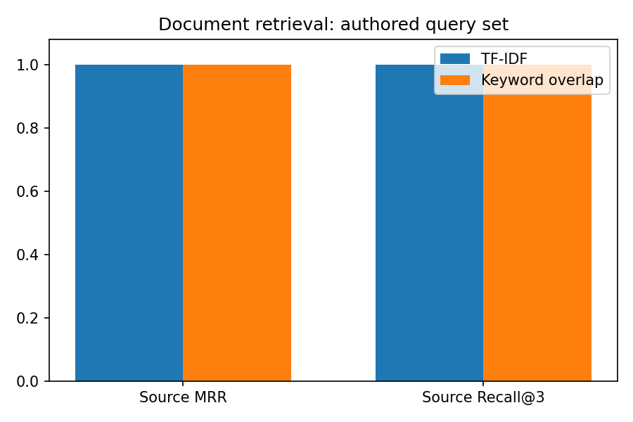

# 本次运行结果

由 `main.py` 实际运行后生成。重新运行可能随依赖版本略有变化。
教学或模拟数据指标不代表真实业务效果。

```json
{
  "tfidf": {
    "source_mrr": 1.0,
    "source_recall_at_3": 1.0
  },
  "keyword_overlap_baseline": {
    "source_mrr": 1.0,
    "source_recall_at_3": 1.0
  }
}
```



完整输出：[`outputs/metrics.json`](outputs/metrics.json)。
